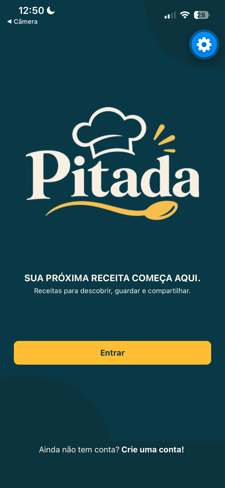
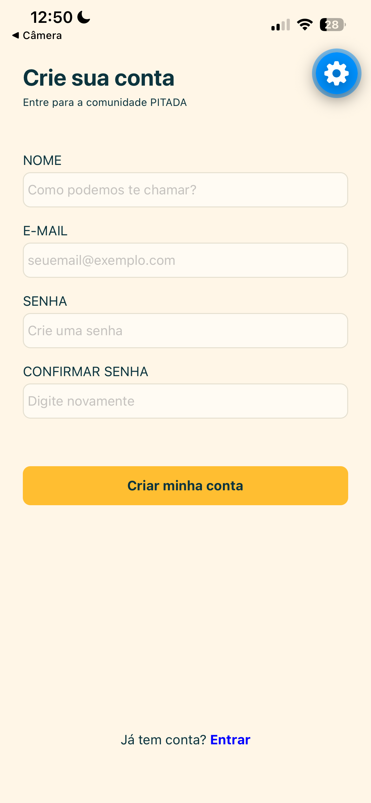
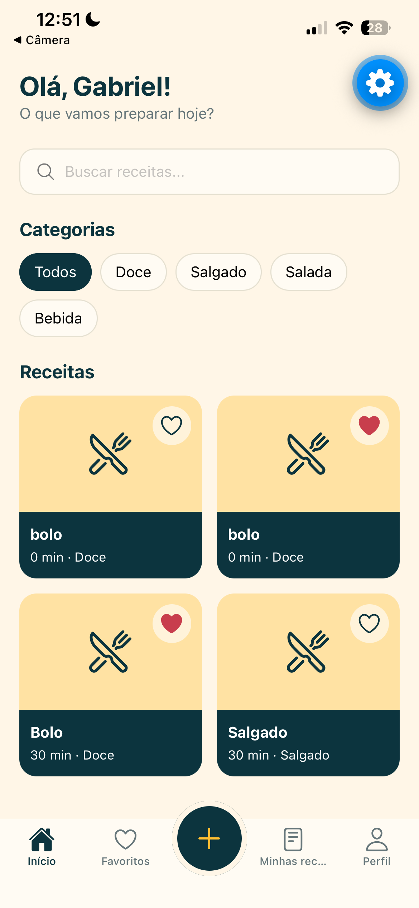
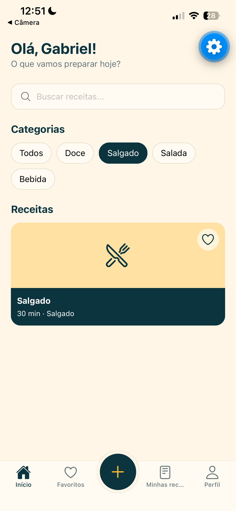
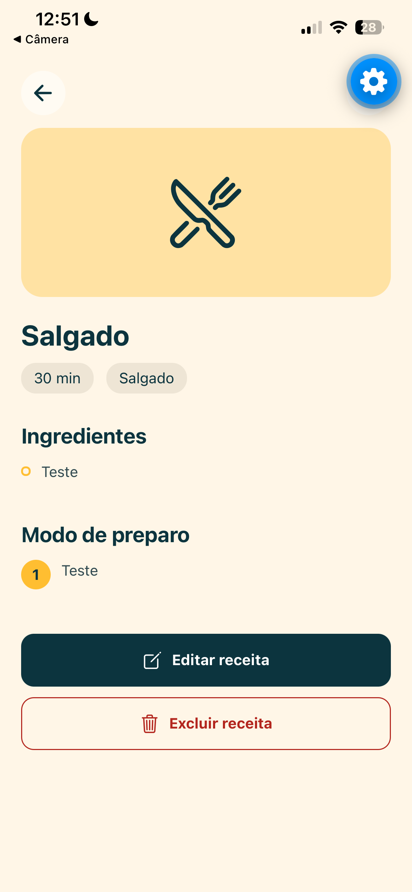
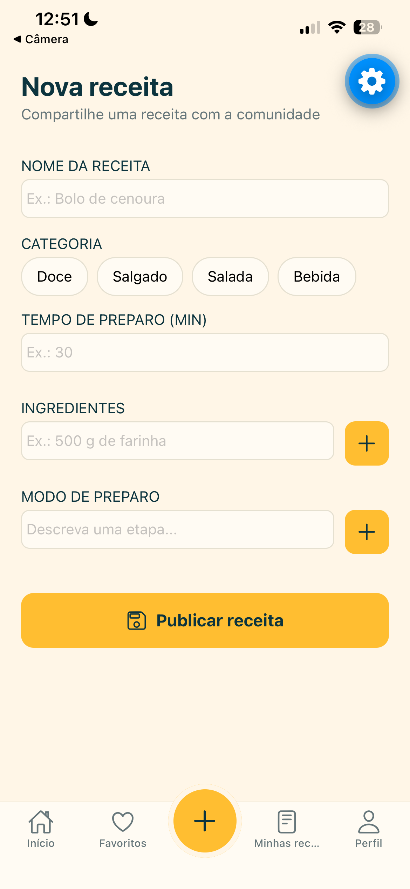
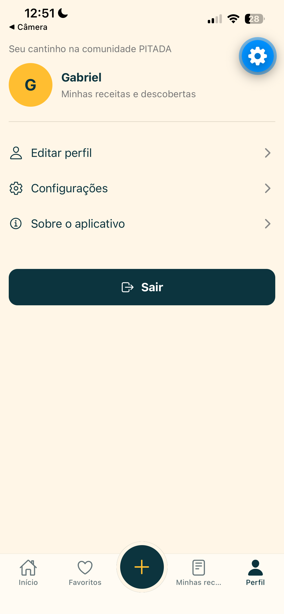

# PITADA - Catálogo de Receitas

O PITADA é um aplicativo móvel acadêmico para descobrir, cadastrar, organizar e compartilhar receitas. O projeto foi desenvolvido com React Native e Expo, seguindo a organização e os recursos trabalhados em aula.

## Integrantes

- [Guilherme Rodrigues ferreira]
- [Pedro Gabriel Oba Classe]
- [Gabriel Tomiura Ishizawa]
- [Isabela Almeida Dias]

## Objetivo

Oferecer um catálogo local de receitas no qual cada usuário possa criar uma conta, publicar e gerenciar suas próprias receitas, consultar receitas da comunidade e manter uma lista pessoal de favoritas.

## Tecnologias

- JavaScript
- React Native 0.88
- Expo SDK 58
- React Navigation (Stack Navigator e Bottom Tabs)
- SQLite com `expo-sqlite`
- AsyncStorage
- Ionicons

## Funcionalidades

- Cadastro, login, edição de perfil e logout.
- Catálogo com busca por nome e filtro por categoria.
- Cadastro, consulta, edição e exclusão de receitas.
- Validação de nome, categoria, tempo, ingredientes e modo de preparo.
- Favoritos separados por usuário e agrupados por categoria.
- Persistência das receitas e dos favoritos no SQLite.
- Persistência do último filtro escolhido no AsyncStorage.

## Estrutura de pastas

```text
App.js                         Stack Navigator principal
index.js                       entrada registrada pelo Expo
assets/                        imagens e ícone do aplicativo
src/
  components/                  componentes reutilizáveis
  context/                     estado do usuário autenticado
  database/                    conexão, esquema e repositories SQLite
  models/                      modelos de usuário e receita
  navigation/                  Bottom Tabs
  screens/                     telas do aplicativo
  services/                    regras de negócio
  validators/                  validações de formulários
```

## Instalação e execução

Requisitos: Node.js, npm e o aplicativo Expo Go compatível com o SDK 58.

```bash
npm install
npx expo start
```

Depois de iniciar o servidor, leia o QR Code com o Expo Go. O computador e o celular devem conseguir se comunicar pela mesma rede. Para limpar o cache do bundler:

```bash
npx expo start --clear
```

Verificações do projeto:

```bash
npx expo install --check
npx expo lint
npx tsc --noEmit
npx expo-doctor
```

## Persistência

O arquivo `pitada.db` é aberto pelo `expo-sqlite`. As tabelas `usuarios`, `receitas` e `favoritos` guardam os dados no aparelho. Ingredientes e etapas são convertidos para JSON porque o SQLite não possui um tipo de coluna para arrays. Os comandos SQL recebem parâmetros, sem concatenar os valores digitados pelo usuário.

O AsyncStorage não substitui o banco. Ele guarda apenas uma preferência simples: o último filtro de categoria selecionado no catálogo.

## Capturas de tela

<table>
  <tr>
    <td align="center">
      <br>
      <strong>Tela inicial</strong>
    </td>
    <td align="center">
      <br>
      <strong>Login</strong>
    </td>
  </tr>
  <tr>
    <td align="center">
      <br>
      <strong>Cadastro de usuário</strong>
    </td>
    <td align="center">
      <br>
      <strong>Catálogo e favoritos</strong>
    </td>
  </tr>
  <tr>
    <td align="center">
      <br>
      <strong>Filtro por categoria</strong>
    </td>
    <td align="center">
      <br>
      <strong>Detalhes da receita</strong>
    </td>
  </tr>
  <tr>
    <td align="center">
      <br>
      <strong>Publicar receita</strong>
    </td>
    <td align="center">
      <br>
      <strong>Perfil</strong>
    </td>
  </tr>
</table>

## Observação de segurança

As senhas das contas locais ainda são armazenadas em texto simples para preservar a compatibilidade com as contas acadêmicas já criadas. Em um aplicativo de produção, seria obrigatório aplicar hash seguro e uma migração das credenciais existentes.
